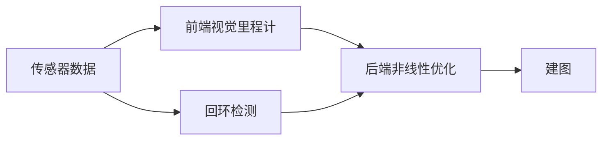

# 经典的视觉SLAM框架

步骤：
1. 传感器信息读取。主要为图像信息的读取和预处理，惯性传感器等信息的读取和同步等。
2. 视觉里程计(Visual Odometry)。估算相邻图像间相机的运动，以及局部地图的样子。VO又称前端(Front End)。
3. 后端优化(Optimization)。后端接受不同时刻视觉里程计测量的相机位姿，以及回环检测的信息，并对他们进行优化，得到全局一致的轨迹和地图。由于接在VO之后，称作后端(Back End)。
4. 回环检测(Loop Closing)。回环检测判断机器人是否到达过先前的位置。如果检测到回环，它会把信息提供给后端进行处理。
5. 建图(Mapping)。它根据估计的轨迹，建立与任务要求对应的地图。

# SLAM问题的数学表达
首先规定
- 传感器在离散时刻$t=1, ... , K$采集数据
- 各时刻的位置记为$x_1, ... , x_k$，构成机器人的轨迹
- 假设地图由许多路标组成，每个时刻传感器会测得一些路标点，得到他们的观测数据，设路标点共有$N$个，用$y_1, y_2, ... ,y_N$表示他们

运动方程可以表示为$$x_k = f(x_{k-1},u_k,w_k)$$
其中$u_k$为运动传感器的读数或输入，$w_k$为运动中的过程噪声。

观测方程可以表示为$$z_{j,k} = h(y_j, x_k, v_{j,k})$$
它描述的是机器人在位置$x_k$看到了某个目标点$y_j$，产生了观测数据$z_{j,k}$，其中$v_{j,k}$为观测过程的噪声。

对于不同的运动类型和传感器，运动方程和观测方程可以进行不同的参数化，如下是描述二维平面运动机器人位姿变化的运动方程和观测方程

SLAM问题可以被描述为一个状态估计问题：如何通过带有噪声的测量数据，估计内部的状态变量。即如何通过运动测量的读数$x$，以及传感器的读数$z$ ,在受到运动过程噪声$w$和测量过程噪声$v$的情况下，求解定位问题(估计$x$)和建图问题(估计$y$)。

根据运动和观测的方式是否线性，噪声是否服从高斯分布，可以分为线性/非线性和高斯/非高斯系统。线性高斯系统(Linear Gaussian)最简单，其无偏最优估计可以由卡尔曼滤波器(Kalmen Filter)给出；在非线性非高斯系统，会使用拓展卡尔曼滤波(Extended Kalman Filter, EKF)和非线性优化两大方法求解。